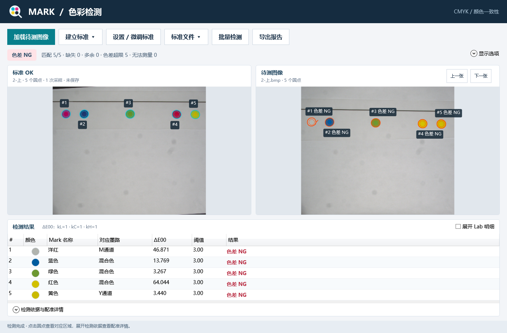

# MarkColorDemo：膜片圆点颜色检测

C++ OpenCV 负责圆点提取、轮廓精修、取色和几何配准；C# WPF 负责建标、质量资格、颜色判定、交互和报告。主入口为 [MarkColorDemo.sln](MarkColorDemo.sln)，包含应用、Native DLL、原生测试和托管验证四个项目。

## 接手从这里开始

1. [项目全局导航与开发指南](docs/项目全局导航与开发指南.md)：环境准备、真实调用链、修改位置、调试与排障。
2. [维护与交接检查表](docs/维护与交接检查表.md)：数据契约、改动后的验证选择、交接范围与本轮整理记录。
3. [代码规范](docs/代码规范.md)：格式规则、注释口径、ABI 和维护约束。

Visual Studio 的“文档”解决方案文件夹也提供这些入口。`docs` 中带日期的功能记录描述当时的改动和验证，不代表当前电脑已经执行过同样检查。

## 准备、构建与运行

开发环境：Windows x64、Visual Studio 2026（C++ 桌面开发及 .NET 桌面开发）、.NET 10 SDK、OpenCV 4.5.4 x64。具体选择见 [.vsconfig](.vsconfig)、[global.json](global.json) 和 [OpenCV.props](build-support/OpenCV.props)。

```powershell
# 在项目根目录执行；检查不会安装工具。
.\setup.ps1 -Mode Check

# 新电脑可双击 setup-dev.cmd；会下载/准备缺失的依赖并构建。
# 有离线 OpenCV 时指定其 build 根目录：
.\setup.ps1 -Mode Development -OpenCvSource 'D:\opencv\build'

# 日常开发使用完整 VS MSBuild，通过脚本或 VS 生成。
.\build.ps1 -Configuration Debug -NoPublish
.\build.ps1 -Configuration Release
```

打开解决方案，选择 **Debug / x64**，将 **MarkColorDemo** 设为启动项目，选择 **MarkColorDemo (C# + C++)** 后按 F5。WPF 引用 Native 工程，生成后自动复制对应配置的 `MarkColorNative.dll`、PDB 和 OpenCV DLL。规则见 [Native.Runtime.targets](build-support/Native.Runtime.targets)。

已构建的发布版本可双击 `run.cmd`。只有源码时应先构建；`publish` 和第三方依赖不在 Git 中。交付运行包用 `prepare-handoff.ps1`，复制其输出的整个目录，不要只复制 EXE。源码交接、开发准备与便携运行包的区别见开发指南。

## 基本操作

1. 选择 **单图建标**，或对同一认可膜片选择 **多图采样建标**。后者按对应圆点对各次拍摄等权平均，并保存跨拍摄波动。
2. 若提取失败、候选过多或质量不足，可直接在失败建标图上重新框选 ROI、预览并重试；取消保留原状态。
3. 加载同版式待测图，查看轮廓、采样内圈、Lab、色差和测量资格。几何对应关系不依赖颜色。
4. 在 **设置 / 微调标准** 中修改参数、标签、逐点目标、阈值和 `kL/kC/kH`；只改比较参数时复用已有测量。
5. 保存标准为 JSON；导出 HTML 查看图文证据，或导出 CSV 做数据分析。批量取消会保留已完成条目。
6. **清除标准并重置** 清空当前图像、结果和参数，ROI 恢复全图；磁盘上已保存的 JSON 保留。

标准的第一张图用于几何和预览，颜色目标可以来自多次采样。读取标准时以保存的目标值为准；原图丢失或哈希改变时不能重提取，但仍可用保存的标准数值比较。



## 测量与判定边界

- 坐标、半径均为原图像素；ROI 为相对整图宽高的 0..1 比例；显示缩放不改变测量像素。
- 候选提取最多保留 256 点供预览；标准及匹配最多 16 点。大视野中应框出同一膜片的完整圆点。
- 外轮廓用于定位；取色区为填充轮廓与默认 0.65 倍半径内圈的交集。Lab 每通道去掉两端各 5% 后平均，像素标准差使用全部内圈样本。
- 默认 `kL=kC=kH=1`。逐点 ΔE00 及启用的通道差限值通过，且几何对应、测量质量和点数均满足条件，才能判整图 OK。
- 配准不确定、无法可靠测量、颜色 NG 和处理错误是不同业务状态。弱对比轮廓的置信指标不是概率。
- 当前是相机 RGB 按 sRGB 假设转换的相对 Lab，**没有实施标准板颜色校准、光源漂移补偿或分光仪级绝对测色**。这些曾讨论的方案不能视为已有功能。
- 默认颜色/质量阈值是演示起点，须用认可样品、临界样和 NG 样验证。RGB/Lab 不直接代表各 CMYK 通道出墨量，墨路名称需要按实际配方确认。

## 修改后如何验证

```powershell
.\format.ps1
.\format.ps1 -Check
.\build.ps1 -Configuration Release

# 需传入原始回归图库：包含“优良品”等约定子目录。
.\verify.ps1 -GalleryRoot 'D:\MarkColorFixtures' -Configuration Release

# 检查 Debug DLL/PDB 能否定位 C++ 源码行。
.\build-support\check-symbols.ps1 -Configuration Debug
```

`verify.ps1` 不隐式构建，图库也不在 Git 中。图库目录改名或移走时，先核对测试夹具约定，不能把错误目录的失败当作算法回归。它会更新 `verification` 下同名报告；保留历史结果时先归档。更多测试模式与数据约定见开发指南。

本项目第三方许可位于 [licenses](licenses/THIRD-PARTY-NOTICES.md)。历史功能和性能数据见 `docs`，不作为当前版本的性能保证。
