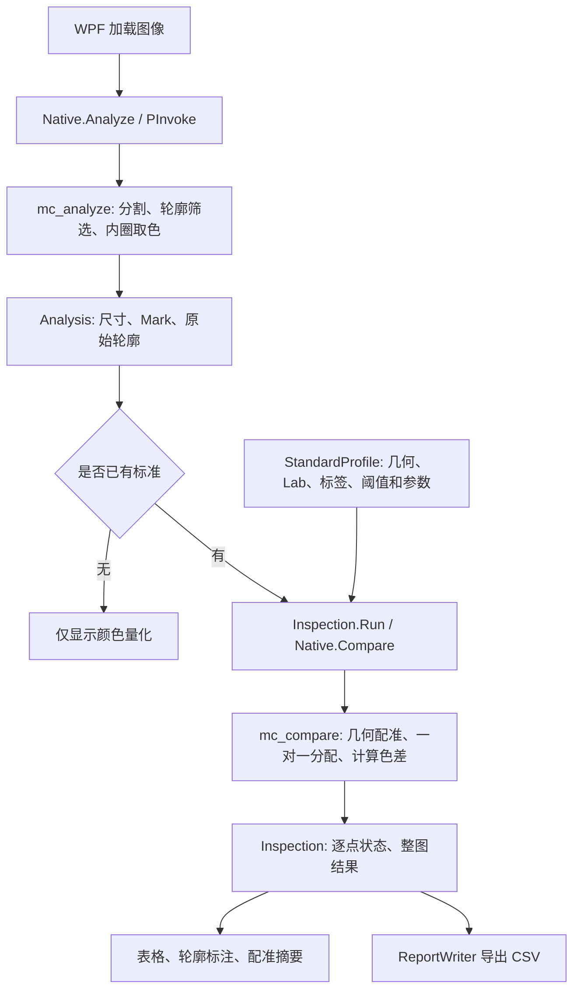

# MarkColorDemo 项目全局导航与开发指南

> 2026-10-16：参数因子、简化界面、命名空间与配准变量说明见 [色差参数与界面简化说明](色差参数与界面简化说明.md)。当前 Native ABI / 标准格式为 v3。

> 当前更新：图标资源、64 倍显示缩放和格式工具入口见 [图标缩放与格式维护说明](图标缩放与格式维护说明.md)，颜色判据解释见 [ΔE00 权重与光照一致性](ΔE00权重与光照一致性说明.md)。

> 2026-10-15：建标恢复流程与大视野性能改动的源码入口见 [建标恢复与性能优化说明](建标恢复与性能优化说明.md)。

> 2026-09-24 升级：多图采样标准、质量检查、强类型结论、弱对比精修、界面预览和便携部署见 [升级功能与使用说明](升级功能与使用说明.md)。Native ABI 已升级为 2，SDK 默认使用项目内 dependencies/opencv/build。

这份指南对应当前统一解决方案 `MarkColorDemo.sln`，用于理解流程、定位源码、调整算法、联合调试和运行回归。先读本文，再按任务跳到具体文件；操作说明和测色适用边界见 [README](README.md)。

## 1. 快速入口

2026-10-16 已按整个项目整理职责和注释。新增分部文件及模型导航见 [全项目代码整理说明](全项目代码整理说明.md)。

| 目的 | 入口 |
|---|---|
| 打开工程、F5 调试 | [MarkColorDemo.sln](MarkColorDemo.sln)，启动项目选 MarkColorDemo，Debug / x64 |
| DLL 导出接口、错误处理、结果生命周期 | [mark_color.cpp](native/src/mark_color.cpp) |
| 修改圆点提取、内圈取色 | [mark_detection.cpp](native/src/mark_detection.cpp) |
| 修改几何配准、缺点和歧义判断 | [mark_matching.cpp](native/src/mark_matching.cpp) |
| 修改 CIEDE2000 数学实现 | [color_difference.cpp](native/src/color_difference.cpp) |
| 修改主界面 | [MainWindow.xaml](src/MarkColorDemo/MainWindow.xaml)、[MainWindow.xaml.cs](src/MarkColorDemo/MainWindow.xaml.cs) |
| 设置应用 / 报告操作 | [MainWindow.Settings.cs](src/MarkColorDemo/MainWindow.Settings.cs)、[MainWindow.Reports.cs](src/MarkColorDemo/MainWindow.Reports.cs) |
| 修改参数默认值、标准文件、合格判定 | [DetectionSettings.cs](src/MarkColorDemo/Models/DetectionSettings.cs)、[StandardProfile.cs](src/MarkColorDemo/Models/StandardProfile.cs)、[Inspection.cs](src/MarkColorDemo/Models/Inspection.cs) |
| 修改轮廓、编号、缺失提示 | [ImageViewport.Rendering.cs](src/MarkColorDemo/ImageViewport.Rendering.cs) |
| 修改缩放、平移、ROI 与选择 | [ImageViewport.cs](src/MarkColorDemo/ImageViewport.cs) |
| 修改多图建标统计 / 测量资格 | [StandardBuilder.cs](src/MarkColorDemo/StandardBuilder.cs)、[QualitySettings.cs](src/MarkColorDemo/Models/QualitySettings.cs) |
| 修改应用图标 | [CmykIcon.xaml](src/MarkColorDemo/Assets/CmykIcon.xaml)、[generate-icon.ps1](build-support/generate-icon.ps1) |
| 查看工作线程处理、分阶段耗时、预览复制 | [DetectionPipeline.cs](src/MarkColorDemo/DetectionPipeline.cs)、[ImagePreview.cs](src/MarkColorDemo/ImagePreview.cs) |
| 修改图文报告 / CSV 导出 | [VisualReportWriter.cs](src/MarkColorDemo/VisualReportWriter.cs)、[ReportExport.cs](src/MarkColorDemo/ReportExport.cs)、[ReportWriter.cs](src/MarkColorDemo/ReportWriter.cs) |
| 添加/修改参数输入项 | [SettingsWindow.xaml.cs](src/MarkColorDemo/SettingsWindow.xaml.cs) |
| 配置 OpenCV | [build-support/OpenCV.props](build-support/OpenCV.props) |
| 查看自动复制规则 | [Native.Runtime.targets](build-support/Native.Runtime.targets)、[MarkColorNative.vcxproj](native/MarkColorNative.vcxproj) |
| 编译、发布 | [build.ps1](build.ps1) |
| 图库与界面验证 | [verify.ps1](verify.ps1)、[tests/Verification/Program.cs](tests/Verification/Program.cs) |
| 阅读代码约定、执行格式检查 | [代码规范](代码规范.md)、[format.ps1](format.ps1) |

VS 解决方案中的“文档”节点包含本指南；“Build configuration”节点提供共享属性表和构建脚本。这些节点只是导航，不是新的编译项目。

## 2. 目录与项目关系

```text
膜片色差整理/
├─ 优良品/、M通道偏小二档/、…    输入图库，程序读取；回归不修改原图
└─ MarkColorDemo/
   ├─ MarkColorDemo.sln           日常开发入口
   ├─ native/
   │  ├─ MarkColorNative.vcxproj C++17 动态库工程
   │  ├─ include/mark_color.h    C ABI 声明、结构体与单位
   │  ├─ src/mark_color.cpp      DLL C ABI 边界与结果生命周期
   │  ├─ src/mark_detection.cpp  圆点提取、内圈取色
   │  ├─ src/mark_matching.cpp   几何配准、一对一分配、比较结果
   │  ├─ src/color_difference.cpp CIEDE2000 数学实现
   │  ├─ src/mark_color_internal.h 模块间内部声明（不导出）
   │  ├─ tests/                 C++ 回归工程和合成数据测试
   │  └─ CMakeLists.txt          可选独立 CMake 入口
   ├─ src/MarkColorDemo/         .NET 10 / x64 WPF 项目；Models/ 按类保存参数/标准/判定
   ├─ tests/Verification/        C# 图库、持久化、判定和离屏渲染验证
   ├─ build-support/            共享编译配置、运行库复制、符号检查
   ├─ standards/                已保存的示例标准；避免用测试覆盖人工微调
   ├─ verification/             回归报告、CSV、界面预览、测试生成的标准
   ├─ build/                    自动生成的中间文件、Native 和测试输出
   ├─ publish/                  Release 可运行发布目录
   ├─ publish/Debug/            Debug 发布目录（执行 Debug 发布时生成）
   └─ licenses/                 第三方许可
```

解决方案包含四个编译项目：MarkColorDemo（WPF）、MarkColorNative（算法 DLL）、native_tests（C++ 验证）、Verification（C# 验证）。修改 `build/`、`bin/`、`obj/` 下生成文件不能持久改变源码配置。旧 `build/native/MarkColorNative.slnx` 属于 CMake 输出，日常使用根目录的 `.sln`。

## 3. 一次检测如何完成



`App.OnStartup` 创建 `MainWindow`。按钮进入 `LoadCurrent` 或 `LoadStandard_Click`，`Execute` 管理忙碌状态和错误提示，耗时 Native 运算由 `Task.Run` 执行。`Refresh` 统一更新标准/待测视图、表格和摘要。批量检测逐图处理，通过取消令牌在当前图处理结束后停止。

设置标准时，`StandardProfile.From` 保存图像尺寸、路径、SHA-256、提取结果及参数副本，为每个点分配标准编号。标准编号和待测检测数组下标是两套概念：对应关系必须取自 `Comparison.ObservedIndex`，不能认为两幅图的第 i 个轮廓必定对应。

## 4. 原生算法导航

`mark_color.cpp` 保留可打断点的 DLL 接口；检测、候选、精修、配准和色差分别在同目录下的实现文件中：

| 函数 | 职责 / 调试时观察 |
|---|---|
| `validateDetectionSettings`（mark_detection.cpp） | 半径、阈值、ROI 等参数的边界检查 |
| `mc_analyze → analyzeImage` | 接口层调用检测流程：读图、候选提取、过滤、测量、排序 |
| `measureMark`（mark_detection.cpp） | 外接圆、面积、圆度、轮廓与内圈交集、Lab/RGB/σ、背景环亮度 |
| `trimmedMean`（mark_detection.cpp） | 各 Lab 通道独立去掉两端各 5% 后求均值 |
| `mc_compare_weighted → compareMarks` | 接口层调用匹配流程：分别验证几何/色差参数、候选配准、排序、歧义判断、写结果 |
| `assignMarks → solveAssignment`（mark_matching.cpp） | 构造几何代价矩阵并完成 Hungarian 一对一分配 |
| `refineTransform`（mark_matching.cpp） | 用已匹配圆心最小二乘细化相似变换 |
| `mc_delta_e00_weighted → calculateDeltaE00`（color_difference.cpp） | CIEDE2000，默认 1/1/1，支持标准中自定义 kL/kC/kH；旧 `mc_delta_e00` 保留默认行为 |
| `mc_get_mark` / `mc_get_contour` | 将结果复制到调用方缓冲区 |
| `mc_release` | 释放本次分析持有的结果和轮廓 |

定位使用饱和度或低灰度分支、局部亮差分支和分通道多尺度边缘候选。候选按圆度、半径、填充率筛选，触及 ROI 边界的圆点不参与检测；精修后再次复核几何。每图最多显示 256 个候选，标准和配准仍最多 16 点；超出配准上限时保留新图并提示框选 ROI。

颜色始终从原图内圈像素测量，配准只变换坐标，不对图像插值后取色。OpenCV BGR8 先归一化为 `[0,1]` 浮点图，再转换 Lab；L* 为 0–100，a*/b* 为带符号值。显示缩放不影响测量。

## 5. 上下偏移与匹配参数

坐标原点在图像左上，x 向右、y 向下。匹配采用标准 → 待测的相似变换：

```text
x' = u*x - v*y + tx
y' = v*x + u*y + ty
scale = sqrt(u²+v²), angle = atan2(v,u)
```

平移上限检查 `sqrt(tx²+ty²) <= MaxTranslation * sqrt(width²+height²)`。不同分辨率先按宽度补偿基准比例；宽高比必须一致到现有容差范围。只处理无镜像的同类版式，小角度旋转和比例变化仍受约束。

| 参数 | 新建标准默认值 | 含义 |
|---|---:|---|
| `MaxTranslation` | 1.00 | 变换平移量相对待测图对角线的上限，允许大幅上下/左右偏移 |
| `MaxRotation` | 10° | 旋转角绝对值上限 |
| `MaxScaleChange` | 0.15 | 分辨率补偿后的比例变化 ±15% |
| `PositionTolerance` | 0.70 | 配准后，圆心距离相对变换后标准半径的上限 |
| `DefaultDeltaE` | 3 | 新建标准逐点色差阈值；不是几何位置容差 |

`优良品/2-上.bmp` 和 `2-下.bmp` 都是 2448×2048、5 个圆点。旧默认平移上限 0.30 约等于 957 px，而实际拟合需要 `tx≈-51.11 px、ty≈1159.83 px`，因此旧配置排除了正确解。新默认值下两图唯一匹配 5/5，比例约 1.04790、旋转约 -0.531°、圆心 RMS 约 3.16 px。精确回归输出见 [vertical-shift.json](verification/vertical-shift.json)。

本次调整保留 C++ 的几何匹配算法，通过参数默认值消除过紧的平移约束。没有改为按颜色猜对应关系，也没有放宽色差阈值。该实拍对在默认 ΔE00=3 时仍有 4 点为色差 NG，不能仅凭目录名“优良品”强行判 OK。

已有 JSON 标准里的显式 `MaxTranslation` 继续生效。若读取旧标准后仍显示匹配不确定，在“设置 / 微调标准 → 圆点提取 / 匹配”中把“最大平移 / 对角线”改为 1，应用并保存。只改匹配参数不会重取色或丢失人工 Lab 微调。重新从样图新建标准则使用当前参数。

颜色不参与配准；布局等间距且部分缺点时，可能存在多个几何解释。此时继续提示不确定是必要行为。反向打印顺序、不同视野、镜像图应建立适合的标准；大平移范围不能补救不同版式或裁剪丢点。

## 6. 判定和界面状态

| 状态 | 表格/叠加行为 | 是否允许整图 OK |
|---|---|---|
| 提取完成，未设置标准 | 原图轮廓、内圈及量化值 | 尚不判定 |
| 几何对应明确 | 使用标准 `#编号`，显示 OK 或色差 NG | 还需满足所有阈值 |
| 对应明确且标准点无观测点 | 表格“缺少圆点”，变换后预期位置画“缺失”虚线圈 | 否 |
| 配准不确定 | 橙色“候选 P编号 · 待配准”，表格“匹配不确定”；不画缺失圈 | 否 |
| 配准明确但检测到额外点 | 橙色“多余 P编号”，不冒用标准编号 | 否 |

轮廓存在只证明提取到了候选。`Inspection.ObservedLabel`、`IsConfirmedMissing` 和 `Summary` 统一标签语义，`ImageViewport.OnRender` 使用这些结果。配准不确定时，Native 仍可能返回一个暂选的候选对应及色差；这些数值不构成通过结论。

逐点 OK 需要 `Comparison.Status==0`，且 ΔE00、所有启用的 |ΔL|/|Δa|/|Δb| 阈值通过。整图 OK 还要求没有额外点、没有匹配歧义。通道差阈值为 0 表示不启用。

## 7. C# / C++ 边界

声明在 `mark_color.h` 和 `Native.cs` 两端严格对应，当前 ABI 版本为 3，Windows x64、cdecl、Pack=8。`McMark/Mark` 为 128 字节，`McComparison/Comparison` 为 80 字节，`McAlignment/Alignment` 为 56 字节，新 `McColorDifferenceSettings/NativeColorDifferenceSettings` 为 24 字节。旧结构体布局不变，新界面通过 `mc_compare_weighted` 显式传入色差因子。

`mc_analyze` 返回结果句柄；C# 使用 `NativeResultHandle : SafeHandle`，读取点和轮廓后释放。不要跨边界传递 `cv::Mat`、STL 对象或 C++ 异常。错误以负返回值与线程局部 UTF-8 文本传出，`Native.Check` 在同一调用线程立即转为 C# 异常。

附加的 `mc_result_timings` 返回本次解码、分割、几何筛选/取色的毫秒数；`mc_result_bgr` 借用已解码 BGR8 缓冲。后者的指针只在句柄释放前有效：C# 必须在 `using(handle)` 内完成 `BitmapSource.Create` 的复制及冻结，不能把借用指针留给后续绘图。原有 ABI 结构体布局未改变，但新界面需要配套生成的 DLL，不能搭配缺少这些新增导出的旧 DLL。

如果要新增 Native 参数或结果字段，必须同步改头文件、C# 结构体、尺寸检查、转换函数和测试；不兼容布局需要升级 ABI 并同步版本检查。此前的平移默认值和显示修复未改变 ABI；当前自定义色差接口使用 ABI v3，防止新版界面加载缺少导出的旧 DLL。

## 8. 配置、编译和 DLL 复制

`MarkColorNative.vcxproj` 直接列出编译和链接选项，并直接导入 `OpenCV.props` 读取共用 SDK 路径/版本；不再通过 `Native.Common.props` 隐藏本项目的编译配置。`Native.Common.props` 仅供 C++ 测试项目使用。`OpenCV.props` 优先使用项目内 `dependencies/opencv/build`，否则当前默认使用 `项目内 dependencies\opencv\build`；版本为 454、SDK 子目录为 `x64/vc15`。`vc15` 是现有 SDK 文件夹名，项目编译器由 `PlatformToolset` 选择。

在 VS 中直接查看：选择 `MarkColorNative → 属性`，先选 Debug / x64 或 Release / x64，再检查下表。附加目录中的宏可在“编辑”窗口查看计算后的实际值。SDK 地址在 `MarkColorNative → 环境与构建配置 → OpenCV.props` 中修改，也可以在属性管理器中打开该属性表查看“用户宏”。修改共用路径后，WPF 自动复制与 C++ 测试同步使用同一 SDK。

| VS 属性页 | 当前设置 |
|---|---|
| C/C++ → 常规 → 附加包含目录 | 项目 include + `$(OpenCvIncludeDir)`，当前为 `项目内 dependencies\opencv\build\include` |
| 链接器 → 常规 → 附加库目录 | `$(OpenCvLibDir)`，当前为 `项目内 dependencies\opencv\build\x64\vc15\lib` |
| 链接器 → 输入 → 附加依赖项 | Debug：`opencv_world$(OpenCvVersion)d.lib`；Release：`opencv_world$(OpenCvVersion).lib` |
| C/C++ → 代码生成 → 运行库 | Debug：/MDd；Release：/MD |
| C/C++ → 优化 | Debug：禁用；Release：最大速度 |
| C/C++ → 常规 → 调试信息格式 | /Zi，链接器同时生成 PDB |

每次生成的输出日志会打印 OpenCV 版本、配置、Include/Link/Runtime 的实际路径，可据此确认生效的环境。

| 配置项 | 文件 |
|---|---|
| SDK 根路径、版本、头文件/lib/bin 路径、Native 输出目录 | `build-support/OpenCV.props` |
| C++ 附加包含目录、库目录、依赖项、/MDd 或 /MD、调试符号 | `native/MarkColorNative.vcxproj`，按 Debug/Release 显式列出 |
| 动态库项目类型、导出宏、算法源文件 | `native/MarkColorNative.vcxproj` |
| WPF 对 C++ 的 ProjectReference、x64、混合调试 | `src/MarkColorDemo/MarkColorDemo.csproj` |
| 复制 Native DLL/PDB 和 OpenCV DLL 到 WPF/发布目录 | `build-support/Native.Runtime.targets` |
| F5 托管与本机联合调试配置 | `src/MarkColorDemo/Properties/launchSettings.json` |

Native 自己生成后的 OpenCV 复制在 `MarkColorNative.vcxproj` 的 `CopyOpenCvNativeRuntime` 中；WPF 端的复制在 `Native.Runtime.targets` 中。Debug 选择 `opencv_world454d.lib/.dll`，Release 选择 `opencv_world454.lib/.dll`。

在 `MarkColorDemo` 文件夹中运行：

```powershell
.\build.ps1 -Configuration Debug -NoPublish  # 编译四个项目并执行 C++ 测试
.\verify.ps1 -Configuration Debug           # C++ + 99 张图库及 WPF 离屏验证
.\build.ps1                                # Release 编译、C++ 测试、发布
.\verify.ps1                               # 验证 Release
.\build-support\check-symbols.ps1          # 检查 DLL/PDB 与源码行
```

使用完整 Visual Studio MSBuild；`dotnet build` 不能替代这里所需的 C++ 工具链。更换 SDK 可编辑 `OpenCV.props`，或临时运行 `build.ps1 -OpenCvDir 'D:\opencv\build\x64\vc16\lib'`。后者只覆盖该次脚本调用，VS 后续 F5 仍使用属性表配置。

| 输出 | Debug 路径；Release 对应替换配置名称 |
|---|---|
| C++ DLL/PDB/LIB | `build/msbuild/native/Debug/` |
| WPF 可执行程序及运行依赖 | `src/MarkColorDemo/bin/Debug/net10.0-windows/` |
| C++ 测试程序 | `build/msbuild/tests/Debug/native_tests.exe` |
| C# 验证程序 | `build/verification/Debug/Verification.exe` |

只修改 `mark_color.cpp` 时，停止调试后对 WPF 项目“生成/重新生成”或 F5，项目引用会先生成 Native 再复制 DLL/PDB。`MarkColorDemo.dll` 是 C# 程序集，C++ 输出是 `MarkColorNative.dll`。发布时复制整个 `publish` 目录，并准备匹配的 .NET Desktop Runtime 和 VC++ 运行环境。

## 9. 常用断点与修改路径

1. VS 打开统一解决方案，选择 Debug / x64，将 MarkColorDemo 设为启动项目，选择 `MarkColorDemo (C# + C++)` 启动配置。
2. 在 `mc_analyze` 内设置断点，F5 后加载图像。初次调用 P/Invoke 后才会加载 Native DLL。
3. 检查提取问题：进入 `mark_detection.cpp`，依次检查 `findCandidateContours`、`passesShapeFilter`、`measureMark` 的 sampleMask/coreMask 与采样数。
4. 检查匹配问题：进入 `mark_matching.cpp`，检查 `settings.maxTranslation` → `isTransformAllowed` → `generateAlignmentFits` → `fits.front().observedIndices`、`alignment`。位移很大但轮廓正常时，先看平移上限。
5. 检查判定问题：`Inspection.Run → CreateRow → PassesColorThresholds` 的 `comparison.Status`、`DeltaE00`、标准逐点阈值。显示问题再看 `Refresh` 和 `ImageViewport.OnRender`。

空心断点一直不生效时，在 VS“调试 → 窗口 → 模块”核对加载的 DLL 路径是否为当前 WPF 输出目录，以及对应 PDB 是否加载。避免同时运行旧 `publish` EXE 和新 Debug EXE造成版本混淆。

添加 UI 参数通常涉及 `DetectionSettings` 默认值/验证、`SettingsWindow.Add` 输入项，以及必要的 Native 转换。修改标准持久化涉及 `StandardProfile`、SchemaVersion、JSON 往返测试。报告格式由 `ReportExport` 分派：`VisualReportWriter` 生成图文 HTML，`ReportWriter` 保留详细 CSV。不要把表格格式化的字符串当作计算原始数据。

## 10. 回归检查和结果文件

`native_tests.cpp` 检查 ABI、CIEDE2000 参考值、分割与轮廓、异常输入、旋转/比例变化、1200 px 双向平移、真实缺点、颜色变化、检测顺序变化和重复间距的歧义。

`tests/Verification/Program.cs` 调用真实 DLL，检查 99 张图库候选数、同视野对应关系、自比对、近白缺墨、上下实拍正反向配准、严格平移上限、真实缺点/多点、标准往返及 WPF 离屏渲染。图库检查默认按本项目现有文件命名判断 1 或 5 个点；新增不同布局图库时应同步调整预期规则。

可仅输出这次上下偏移的诊断（工作目录仍为 MarkColorDemo）：

```powershell
.\build\verification\Debug\Verification.exe .. --pair-report
```

该入口对比 0.30 和 1.00 两个平移上限，不修改图片或标准文件。完整回归会在 `verification/` 写报告、CSV、JSON、截图及 `generated-standards/`；不会覆盖 `standards/` 中的人工标准。

重点结果：

- `vertical-shift.json`：上下样图修复前后对应关系与逐点色差。
- `vertical-shift-preview.png`：5/5 成功匹配的完整界面。
- `uncertain-alignment-preview.png`：显式使用旧 0.30 上限时的候选标注，无虚假缺失圈。
- `verification.txt` / `verification-debug.txt`：各配置回归摘要。
- `gallery-comparisons.csv`：图库逐点测量与判定。

回归通过说明当前测试覆盖范围内的提取、配准和判定行为正确，不代表已经标定生产误检/漏检率。默认 ΔE00=3 仍需基于固定成像条件下的多次 OK 和已知 NG 样本确定。当前相机 RGB 按 sRGB 假设转换 Lab，没有相机色彩标定或多张标准统计模型。
